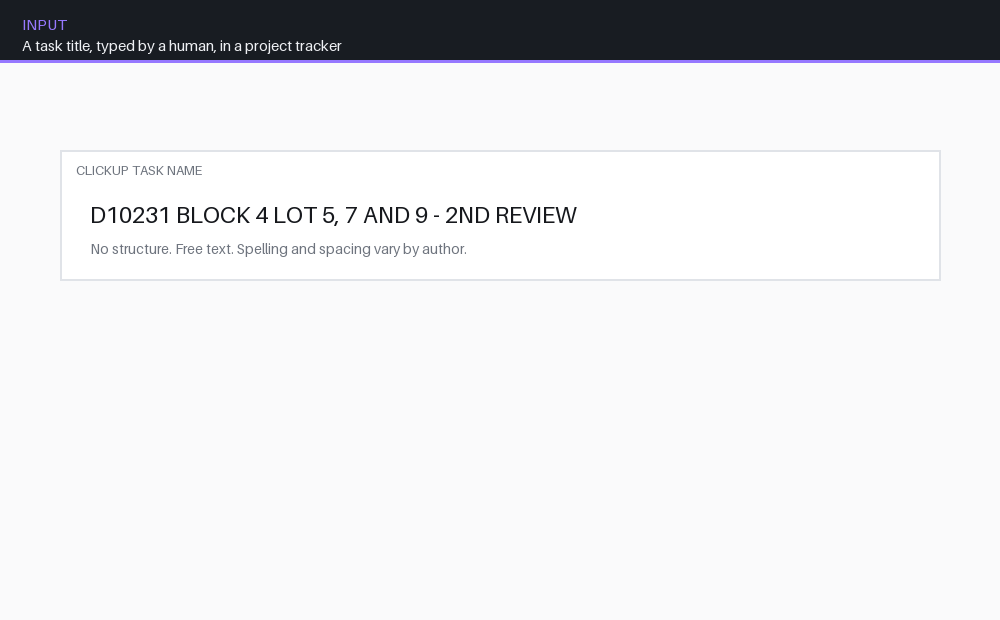

# Predictive Workload Management System



Work arrives as short, hand-typed entries in a project tracker — a line of text
and a due date — which says nothing about how much work any of them actually is.
This tool reads those entries, finds each one's matching project files, works
out how large and complex the job really is, and turns a list of tickets into a
picture of how much work is coming and when each piece can start.

The point is that ten easy jobs and ten hard ones look identical in a tracker,
and a schedule built on that count is wrong before anyone starts.

*Every value in the animation is computed by calling the real functions in this
repository. Only the input title is invented.*

---

## The interesting problems

### Free text is the input format, and it cannot be changed

The entries are typed by people under time pressure, so the same intent arrives
many ways: `BLOCK 1 TO 3`, `BLK 2`, `LOT 5, 7 AND 9`, `BBs (1, to 4, 6 to 8)`,
plus a long tail of spacing and punctuation variants. Nothing downstream can run
until each of these becomes an explicit set.

Rather than rejecting malformed input — which just moves the work back to the
person who was in a hurry — the parser expands what it can and reports what it
cannot. Ranges, comma lists, the connecting words `TO` and `AND`, parenthesised
groups and plural forms are all handled, and a title with no recognisable
project code returns empty sets so the caller skips it rather than guessing.

### Counting tickets is the wrong measure, so it scores complexity instead

Each entry is matched to its schedule workbook, and complexity is computed from
what is actually in it:

```
base difficulty   from a square-footage tier    (thresholds loaded from config)
elevation bonus   (number of elevations - 1) x 0.1
difficulty        base + bonus
```

Tier thresholds live in a remote configuration sheet rather than in the source,
so the scoring can be retuned without a deploy — with documented fallback values
if that sheet is unreachable. The resulting KPI is `difficulty / duration in
business days`, which means a hard job finished slowly and an easy one finished
fast stop reading the same.

### A job is not startable when it is created

This is the part that makes the system forward-looking rather than a report of
what already happened. A model cannot begin until *all* of its input drawings
have landed, so the startable date is derived, not entered:

```python
startable = max(architectural_date, floor_date, truss_date) + 1 day
```

Blocks roll up: a block's date is bounded by its own inputs *and* by the latest
of the models it contains, because a block is not ready before its contents are.
That turns a set of scattered input dates into a view of when load actually
arrives.

### The pipeline runs on a schedule, so it has to converge

It re-runs hourly against live data, which means every operation has to be safe
to repeat and safe to interrupt:

- **Scope changes are detected, not accumulated.** Models that no longer match a
  parent entry have their rows purged rather than left behind as orphans.
- **Contested ownership resolves deterministically.** When two entries share a
  project code and both claim the same model, the later-dated parent wins and
  the loser's rows are removed — so two runs in either order reach the same
  state.
- **Rate limits are assumed, not hoped against.** Both the tracker API and the
  spreadsheet API are wrapped in exponential backoff with jitter, writes are
  batched, and the sheet is only re-read when rows were actually deleted.

---

## Try it without credentials

The parsing and scoring layer is pure — no network, no spreadsheet — so it runs
on its own:

```bash
pip install -r requirements.txt
python examples/parse_demo.py
```

That prints the expansion of a set of synthetic titles, which is the clearest
view of what the pipeline actually reasons about.

```bash
pip install pytest
python -m pytest tests/ -q     # 34 tests
```

The suite covers the parsers with synthetic fixtures — hand-typed variants,
sorting and deduplication, the review-suffix trim, and the rule that block
numbers must not also be read as lot numbers. No tracker token, no Google
credentials, no network.

## Running it against real data

The live jobs need credentials, read from the environment and never committed:

| Name | Where | Purpose |
|---|---|---|
| `CLICKUP_TOKEN` | env var / CI secret | tracker API token |
| `CLICKUP_WORKSPACE_ID` | env var / CI secret | workspace to query |
| `creds.json` | file, gitignored | Google service-account key |
| `DASHBOARD_PASSWORD` | `st.secrets` | dashboard access |

```bash
python ClickUpQA.py       # consistency checks, creates QA subtasks
python snapshotter.py     # snapshot task state to the sheet
streamlit run app.py      # dashboard
```

## What was changed for public release

This began as an internal tool with the firm's own resource identifiers compiled
into it. Preparing it to be published was not only a matter of deleting things:

- **Every resource identifier is now configuration**, read from an environment
  variable with an obviously-fake default, instead of a literal in the source.
- **The domain vocabulary is now a named constants block.** The project-code
  pattern and the keywords for groups and units are declared in one place at the
  top of `expander.py` and referenced everywhere else, so the extraction can be
  retargeted at different naming without touching its logic.
- **Two direct imports were undeclared** and worked only because other packages
  pulled them in. They are declared and the dependency set is pinned.
- **The dashboard's authentication was rebuilt.** It previously accepted the
  password as a URL query parameter and fell back to a default when the secret
  was unset. It now reads the secret only, refuses to start if it is missing,
  and compares in constant time.

[`ADAPTING.md`](ADAPTING.md) walks through what is genuinely specific to this
domain, what is one constant away from being general, and what would have to be
replaced to point it at a different tracker.

## Scope and limitations

- **The tracker and spreadsheet backends are not abstracted.** It talks to the
  ClickUp and Google Sheets/Drive APIs directly. Swapping either means writing a
  new module, not changing a setting — see `ADAPTING.md`.
- **The schedule parser expects a particular column layout** (series, model,
  elevations, square footage, then dated columns found by header). A differently
  shaped workbook needs `load_and_parse_schedule` adjusted.
- **`extract_allowed_targets` is intricate.** Seven overlapping regex handlers
  build the model-name variants, and that section is deliberately the least
  test-covered part of the suite — asserting behaviour there without real inputs
  risked encoding a misreading as a passing test. It is the first place to add
  coverage.
- **Difficulty is a heuristic, not a model.** It is a tiered lookup plus a linear
  elevation term, chosen because it is explainable to the people it schedules.
  It is not fitted to outcome data.
- **No assignment or dispatch.** The system quantifies and forecasts load; it
  does not allocate it to people.
- Dates are handled in a single fixed timezone.

## Layout

```
expander.py       parsing, schedule matching, difficulty, derived dates
snapshotter.py    tracker -> sheet state snapshots
ClickUpQA.py      consistency checks and QA subtask creation
app.py            dashboard (Streamlit)
examples/         credential-free parsing demo
tests/            pytest suite over the parsers
```

## Provenance

Developed at **D.L. Engineering Inc.** and published with the firm's written
permission. Client information, firm documents, internal resource identifiers
and proprietary data are excluded — every workspace, sheet and folder identifier
in this repository is a placeholder.

Licensed under the MIT License.
